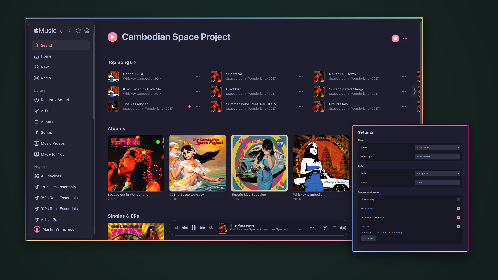

<h1 align="center">
  
  <br />
  Lidra
</h1>

<p align="center"><b>Apple Music as a proper desktop app for Linux, macOS and Windows.</b></p>

<p align="center">Made with 💝 for 🐧🍏🪟</p>

Lidra wraps `music.apple.com` directly: Apple owns the interface and keeps it current, while Lidra wires it into each platform's native media subsystem (media keys, MPRIS, Now Playing, taskbar controls) instead of bolting on a custom player. An Apple Music subscription is required for playback.

> **Fork note:** Lidra is a fork of [wimpysworld/sidra](https://github.com/wimpysworld/sidra) (Blue Oak 1.0.0, © Martin Wimpress). UI, theming, sign-in flow and release infrastructure are unchanged from upstream. The playback stack is replaced: Lidra serves Apple Music's lossless, hi-res and Dolby renditions through its own audio pipeline instead of Chromium's DRM path. See [Audio pipeline](#audio-pipeline) and [docs/AUDIO-PIPELINE.md](docs/AUDIO-PIPELINE.md).

<p align="center">
  <a href="assets/lidra-screenshot.png"></a>
</p>

## Audio pipeline

Lidra keeps Sidra's interface, sign-in, theming and integrations, and replaces the playback stack underneath them.

- **No Chromium DRM.** Stock Electron: no Widevine CDM, no EVS/VMP signing. The page's player is satisfied by a loopback HLS playlist instead of a protected CDN stream.
- **Quality comes from the master manifest**, not from what the web player is offered: hi-res ALAC (up to 24-bit/192 kHz), ALAC lossless, Dolby Atmos (E-AC-3), Dolby Audio (AC-3) and AAC. Lidra asks the Apple Music API for `extendedAssetUrls.enhancedHls` with the session you signed in with, ranks every rendition and plays the best one your preference allows.
- **Fragments are decrypted and muxed as they arrive.** Nothing waits for a full download: the player's manifest request is held only until the first two seconds exist, so pressing play starts audio in well under a second.
- **The page still owns playback.** Because Lidra answers the manifest request with its own playlist, the media element, transport, queue, scrubbing and player bar stay exactly as upstream — seeking included.
- **Decryption runs in the app**, driven by a key source you supply: a key service (socket or HTTP) or the wrapper decrypt socket described in [docs/AUDIO-PIPELINE.md](docs/AUDIO-PIPELINE.md).

| Source | Delivered as | Needs ffmpeg |
| --- | --- | --- |
| AAC-LC / HE-AAC | stream copy (fMP4) | no |
| ALAC lossless / hi-res | FLAC in fragmented MP4 (bit-exact) | yes |
| Dolby Atmos (E-AC-3) | FLAC, 5.1 preserved | yes |
| Dolby Audio (AC-3) | FLAC, 5.1 preserved | yes |

Configuration lives in the Audio section of Settings or the environment:

| Variable | Purpose |
| --- | --- |
| `LIDRA_AUDIO_ENABLED` | `0` disables the pipeline and leaves the page's own playback alone |
| `LIDRA_AUDIO_QUALITY` | `hi-res`, `lossless`, `atmos`, `dolby-audio`, `aac`, or `auto` |
| `LIDRA_KEY_SERVICE` | `host:port`, `unix:/path` or `http(s)://…` key service |
| `LIDRA_KEY_TRANSPORT` | `socket` (default) or `http` |
| `LIDRA_KEY_TOKEN` | bearer token for an HTTP key service |
| `LIDRA_DECRYPTOR` | wrapper decrypt socket; switches playback to remote decryption |
| `LIDRA_MANIFEST_SERVICE` | wrapper manifest socket, for masters the API omits |
| `LIDRA_FFMPEG` | explicit ffmpeg path |
| `LIDRA_WIDEVINE_DEVICE` | `.wvd` file (or directory with `client_id.bin` + `private_key.pem`) for the built-in Widevine licence exchange |

### Legal

Lidra is an alternative playback client for people with a legitimate, active Apple Music subscription. It is not intended to provide unauthorised access to subscription content, bypass payment, distribute copyrighted audio, or facilitate piracy.

A valid subscription establishes legitimate access to a service; it does not by itself authorise circumventing technological protection measures. Whether a particular implementation is lawful access, interoperability or prohibited circumvention depends on how it operates, on Apple's agreements, and on applicable law, including the DMCA and its exemptions.

Lidra bundles no key-extraction or DRM-circumvention tooling. It implements authorised APIs, local decryption of streams you are entitled to play, and playback paths you configure yourself. Review any third-party key service or wrapper you connect for licensing, security and legal compliance before using it. This notice states intended use; it is not a legal opinion or a declaration that every technique is permissible.

## Features

- 🎧 Untouched audio — no `AudioContext`, DSP, or resampling of its own
- 🎨 Eight bundled themes plus a live-reloading custom colour theme
- 📊 Opt-in Last.fm scrobbling (browser approval)
- 🎮 Discord Rich Presence
- 🔔 Track and radio-song desktop notifications with playback controls
- 🌍 32 languages, Apple Music Classical support, gamepad navigation
- 🐧 Linux: MPRIS over D-Bus, Wayland + X11, tray indicator
- 🍏 macOS: Now Playing widget, Dock menu and progress, share sheet
- 🪟 Windows: GSMTC flyout, taskbar toolbar and progress
- 🔄 Auto-update on AppImage/Windows; release-page notifications elsewhere

## Install

Grab the latest release from [GitHub Releases](https://github.com/evangit2/lidra/releases) — `Lidra-*` AppImage, `.deb`, `.rpm`, `.flatpak`, `.snap`, `.dmg`, and the Windows installer. No Snap Store release yet, so install the `.snap` file from there directly.

Unsigned macOS/Windows builds need the usual Gatekeeper/SmartScreen workaround on first launch.

## Develop

Requires Node (see `.nvmrc`).

```bash
npm ci
npm test      # unit tests; type-checks and packaging run in CI
just run      # builds and launches the app
```

Go deeper: [SPECIFICATION.md](docs/SPECIFICATION.md), [custom-theme.json](docs/custom-theme.json), [LASTFM-PRIVACY.md](docs/LASTFM-PRIVACY.md).

## Contributing

- Bugs and feature requests go in [Issues](https://github.com/evangit2/lidra/issues); pull requests welcome
- Commit messages follow [Conventional Commits](https://www.conventionalcommits.org/)
- Be kind: [Code of Conduct](CODE_OF_CONDUCT.md)
- Security issues stay private: [SECURITY.md](SECURITY.md)

## License

[Blue Oak Model License 1.0.0](LICENSE) — do almost anything, just keep this notice and don't sue over it.
